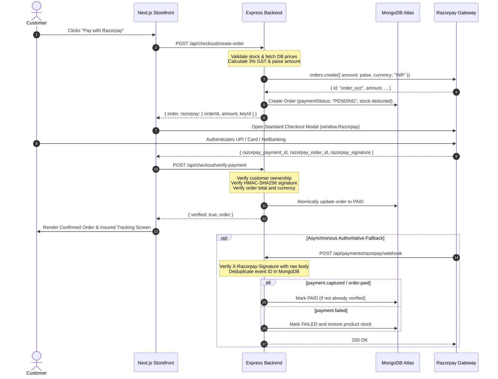

# PERALAGAE — Razorpay Standard Checkout Integration Guide

## 1. Overview & Architecture

This document describes the end-to-end integration of **Razorpay Standard Checkout** into the PERALAGAE fine jewellery e-commerce platform.

The system replaces the legacy checkout simulation with an official, cryptographically verified payment flow. The architecture strictly enforces server-side authority:
- All payable amounts, taxes (3% GST inclusive rule), shipping, and item prices are computed authoritatively on the backend from MongoDB records.
- Browser-supplied amounts, GST calculations, or payment statuses (`paymentStatus: "PAID"`) are strictly ignored and rejected.
- Payments are only marked `PAID` after HMAC-SHA256 signature verification or trusted Razorpay API verification.
- Webhooks run with raw-request-body verification, event deduplication, and atomic stock management.

---

## 2. Environment Variables Configuration

Both backend and frontend utilize separate environment configuration with test and live credentials.

### Backend (`apps/backend/.env`)

```env
# Razorpay Gateway Configuration
RAZORPAY_KEY_ID="rzp_test_..."          # Public Key ID (from Razorpay Dashboard)
RAZORPAY_KEY_SECRET="your_key_secret"   # Server-side Secret (NEVER expose to frontend)
RAZORPAY_WEBHOOK_SECRET="your_wh_secret" # Secret configured in Razorpay Webhooks tab
RAZORPAY_MODE="test"                     # "test" or "live"
FRONTEND_URL="http://localhost:3000"     # Public HTTPS frontend URL in production
```

> [!CAUTION]
> `RAZORPAY_KEY_SECRET` and `RAZORPAY_WEBHOOK_SECRET` must **NEVER** be committed to Git, logged, or sent to browser clients.

### Frontend (`apps/frontend/.env.local`)

```env
NEXT_PUBLIC_API_URL="http://localhost:4000/api/v1"
NEXT_PUBLIC_BACKEND_URL="http://localhost:4000"
```

The frontend dynamically queries `GET /api/checkout/config` to obtain the public `keyId`, `currency`, and `mode`.

---

## 3. End-to-End Payment Lifecycle



---

## 4. Razorpay Webhook Configuration

Webhooks act as an asynchronous source of truth if a customer closes their browser window before frontend redirection completes.

### Dashboard Setup
1. Log in to the [Razorpay Dashboard](https://dashboard.razorpay.com/).
2. Navigate to **Settings → Webhooks → Add New Webhook**.
3. **Webhook URL**:
   - Production: `https://api.yourdomain.com/api/payments/razorpay/webhook` (or `/api/checkout/webhook`)
   - Local Testing: Use ngrok / Cloudflare Tunnel: `https://<tunnel-id>.ngrok-free.app/api/payments/razorpay/webhook`
4. **Secret**: Enter a high-entropy secret and paste it into backend `.env` as `RAZORPAY_WEBHOOK_SECRET`.
5. **Active Events**:
   - `payment.captured`
   - `payment.failed`
   - `order.paid`

### Idempotency & Concurrency Guarantees
- Every processed webhook event ID is recorded in the `RazorpayWebhookEvent` collection. Duplicate delivery attempts are immediately ignored.
- If a late `payment.failed` event arrives for an order already verified as `PAID`, the system preserves the `PAID` state and prevents accidental stock changes.
- If a payment fails on an unpaid pending order, stock is restored atomically using Prisma `$transaction`.

---

## 5. Security & Verification Controls

1. **Raw Body Cryptographic HMAC-SHA256 Verification**:
   The webhook endpoint uses the raw request payload buffer captured in `apps/backend/src/app.ts` (`req.rawBody`) to prevent any JSON parser mutation from invalidating signatures.
2. **Timing-Safe Equality**:
   Payment signatures and webhook signatures use `crypto.timingSafeEqual` to prevent side-channel timing attacks.
3. **Strict Customer Ownership Enforcement**:
   Customers can only verify payments for orders they legitimately placed (`order.customerId === req.customer.id`). Unauthorized attempts are rejected with HTTP 403 Forbidden.
4. **Client Tamper Proofing**:
   Any incoming `paymentStatus: "PAID"` or client-supplied amount in the creation payload is completely ignored. The backend computes the payable total independently.
5. **No Cash on Delivery (COD)**:
   COD is strictly rejected with HTTP 400 `COD_NOT_ALLOWED` across all checkout paths to protect high-value hallmarked jewellery shipments.

---

## 6. Pre-Production Smoke Tests

Before switching `RAZORPAY_MODE` from `test` to `live`:

- [x] Run `npm run typecheck` across both backend and frontend.
- [x] Run `vitest run tests/razorpay-checkout.test.ts` to ensure 100% pass on order creation, signature verification, and webhooks.
- [x] Test dismissal of Razorpay modal: order remains `PENDING` and allows retry without creating a duplicate order.
- [x] Test simulated UPI success using Razorpay test UPI ID `success@razorpay`.
- [x] Verify order status shows `PAID (Verified)` on customer `/orders/[id]` and admin `/admin/orders/[id]`.
- [x] Verify Admin panel provides a "Reconcile with Razorpay API" button for audit recovery.

---

## 7. Production Go-Live Steps

1. **Activate Razorpay Merchant Account**: Complete KYC on the Razorpay Dashboard.
2. **Generate Live API Keys**: Under **Settings → API Keys**, generate Live Key ID & Secret.
3. **Configure Production Environment**: Set `RAZORPAY_MODE="live"`, `RAZORPAY_KEY_ID`, `RAZORPAY_KEY_SECRET`, and `RAZORPAY_WEBHOOK_SECRET` in production server variables.
4. **Deploy Webhook**: Configure the live webhook URL on Razorpay Dashboard with SSL (HTTPS) enabled.
5. **Live Smoke Test**: Complete one small live INR transaction (e.g., silver coin or minimal test product), verify webhook delivery in Razorpay Dashboard logs, and refund through dashboard.
